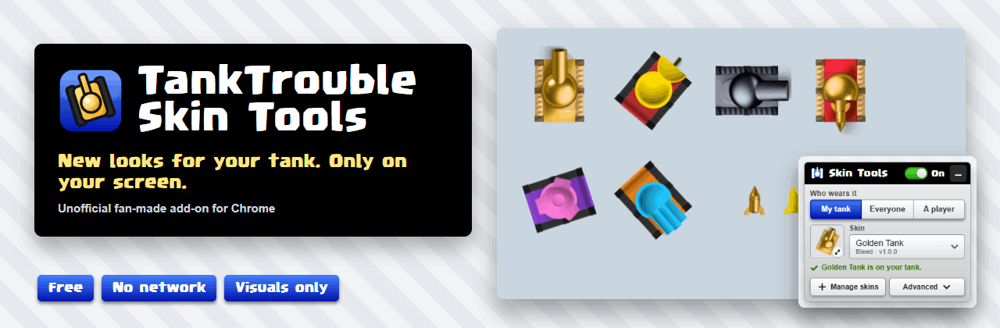
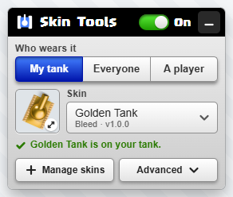
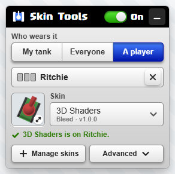
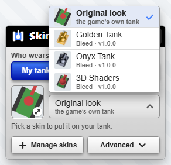
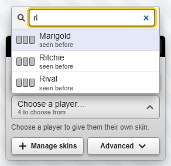
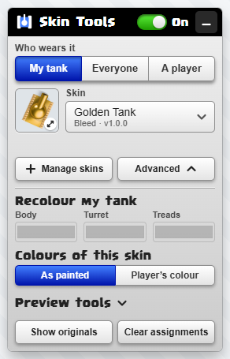
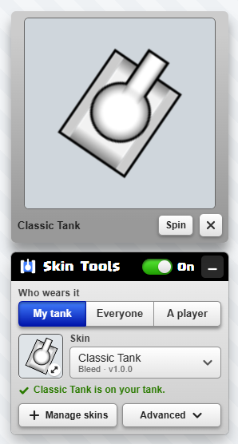
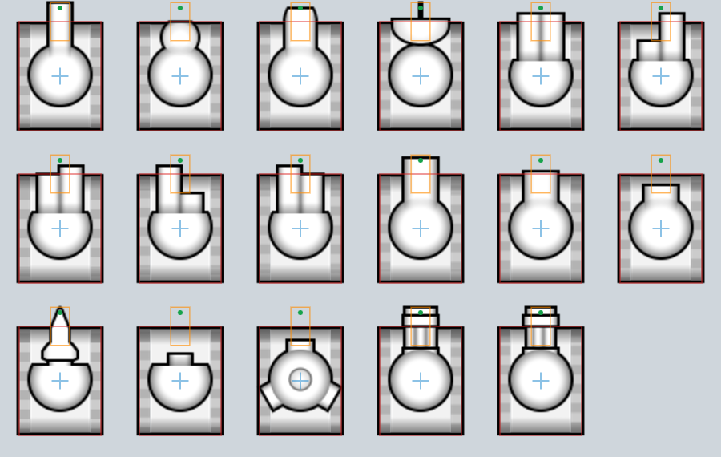
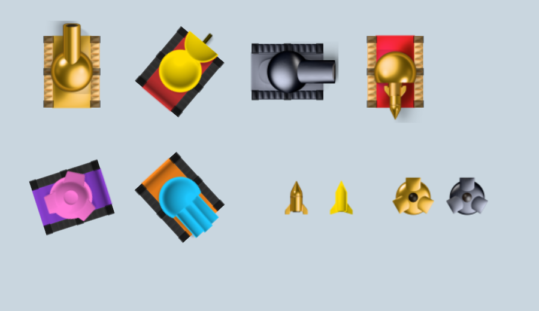

<p align="center">
  
</p>

<h1 align="center">TankTrouble Skin Tools</h1>
<p align="center"><b>New looks for your tank. Only on your screen.</b><br>
A small, free, unofficial add-on for Chrome that changes how tanks <i>look</i> in <a href="https://tanktrouble.com">TankTrouble</a>.</p>

<p align="center">
  <a href="../../releases/latest"><b>⬇ Download the latest release</b></a> ·
  <a href="#quick-start">Quick start</a> ·
  <a href="#faq-and-troubleshooting">FAQ</a> ·
  <a href="docs/MAKING-SKINS.md">Make a skin</a>
</p>

> **Unofficial and visual only.** This is a fan-made add-on, not made or endorsed by the makers of TankTrouble. It only changes
> pictures and colours **on your own screen**. Other players never see them. It does not play for you, automate anything,
> or change speed, hitboxes, bullets or the game's rules.

## Quick start

1. **Download** `TankTrouble-Skin-Tools-1.0.0.zip` from the [latest release](../../releases/latest) and **unzip** it.
2. Open `chrome://extensions`, switch on **Developer mode**, click **Load unpacked** and choose the `extension` folder.
3. Open [tanktrouble.com](https://tanktrouble.com) and click the small black **Skins** button (bottom right).
4. **Manage skins → Add a folder**, pick a folder from `skin-packs`, then choose it under **Skin**. Done.

The ZIP also contains **`START-HERE.html`**, a picture-by-picture guide with troubleshooting.

## What you get

- 🎨 **Pick a skin** for your tank, for everyone, or for one player you search by name. A pick applies at once.
- 🟡 **Three example skins** included: **Golden Tank**, **Onyx Tank** and **3D Shaders** (keeps each player's colours and makes their tank look 3D).
- 🖌️ **Recolour** the body, turret and treads, or show a skin exactly as painted or tinted with each player's colour.
- 📥 **Import your own skins** (a folder of PNGs), preview them, remove them.
- 🔘 **One switch** puts the game's own look back, with your choices kept.
- 🔒 **No network, no tracking, no permissions.** Everything stays in your browser.

<p align="center">
  
  
  
</p>

## Download and install

1. Go to the [Releases page](../../releases/latest) and download **`TankTrouble-Skin-Tools-1.0.0.zip`** (about 800 KB). Ignore the
   "Source code" files; they are for developers.
2. **Unzip** it: right-click → *Extract All…* on Windows, double-click on a Mac. Keep the folder somewhere it can stay (for example
   *Documents*), because Chrome runs the add-on from it.
3. Open **`chrome://extensions`** (Edge: `edge://extensions`, Brave: `brave://extensions`).
4. Switch on **Developer mode** (top right).
5. Click **Load unpacked** and choose the **`extension`** folder.

<p align="center"></p>

Requires Chrome or a Chrome-based browser, version 120 or newer, on a computer. To update, download the new ZIP, replace the
folder, and press the reload icon on the extension's card in `chrome://extensions`.

## Using it

| I want to… | Do this |
|---|---|
| put a skin on my tank | **Who wears it: My tank**, then pick a skin from the list |
| give everyone a skin | **Everyone**, then pick a skin |
| give one player a skin | **A player**, type part of their name, pick them, then pick a skin |
| see a skin bigger | click the small picture next to the skin list |
| recolour | **Advanced → Recolour** |
| go back to normal | flick the switch to **Off**, or pick **Original look** |
| forget every choice | **Advanced → Clear assignments** (skins stay installed) |
| delete a skin | **Manage skins** → the bin next to it |

<p align="center">
  
  
  
</p>

## Create and import skins

A skin is a folder of PNG pictures (the body, the treads and the turret frames) plus a small `skin.json`. Import one with
**Manage skins → Add a folder**, or drag its files onto the panel. If something is wrong, the panel names the picture and the size
it expected. Painting at 2× or 4× the game's size is fine; it is reduced for you. The full guide, with sizes for every picture,
is in [docs/MAKING-SKINS.md](docs/MAKING-SKINS.md).

### Skin Creator Starter Kit (optional, separate download)

Want to make your own skin? The **Skin Creator Starter Kit** has everything to begin, in a small download of its own (about 0.6 MB) so
the add-on stays tiny:

- **Blank templates**: empty transparent PNGs at exactly the right canvas size (body, tread, turret at 1×, 2× and 4×), plus the same
  canvases with **guides** for the tank's centre, muzzle, hitbox and tread positions and the **outline of the familiar white tank**, plus one
  shape guide for every turret frame.
- **A layered Photoshop template** with the whole tank in place and the white tank as a faint tracing layer (Krita, GIMP and Procreate can
  open it too).
- **A complete example skin, "Classic Tank"**, that you can import straight away: the plain white TankTrouble tank (drawn from scratch, in
  the game's own proportions) with body, treads, the 12-frame tread animation and all 17 turret frames (every weapon and its animation), a
  documented `skin.json`, and it takes every player's colour like the game's own tank.
- **A short illustrated guide** for Photoshop, GIMP, Krita and Procreate that explains how the body, treads, turret frames and
  weapon animations fit together, how to export, and how to fix the problems the panel reports.
- **Optional tools for artists**: turn the PSD into a skin, or convert a texture atlas (a PNG sheet + JSON list) into one.

<p align="center">
  
  
</p>

Download **`TankTrouble-Skin-Creator-Starter-Kit-1.0.0.zip`** from the
[Starter Kit release](../../releases/tag/starter-kit-v1.0.0) (it is a separate release; the add-on's download above is unchanged), unzip
it and open **`START-HERE.html`**.

## How it works

TankTrouble draws its tanks from small pictures, tinted with each player's colours. Skin Tools runs inside the TankTrouble page
in your browser, notices when the game creates a tank, and swaps in the pictures of the skin you picked for that tank (and
applies the colours you chose). Your skins and choices are saved in your browser, on your computer. Nothing is sent to the game's
servers or anywhere else, so nobody else sees your skins.

<p align="center"></p>

## Privacy and safety

- **No network use at all.** The add-on contains no code that connects to anything, and asks the browser for **no permissions**.
- It runs **only on `https://tanktrouble.com`**, has no analytics, no tracking and no remote code.
- It doesn't read your account, password or messages, and sends nothing to the game that you wouldn't send anyway.
- Your skins and choices are stored in tanktrouble.com's own browser storage and can be deleted any time. Details: [PRIVACY.md](PRIVACY.md).
- Every release is built from an explicit file list and audited; see [docs/SECURITY-AUDIT.md](docs/SECURITY-AUDIT.md).

## Known limitations

- Skins are **only visible to you**. That is by design, since nobody else has the add-on's pictures.
- Chrome-based browsers on a computer only (no Firefox, Safari or phones).
- Because it's installed with *Load unpacked*, Chrome may remind you about developer-mode extensions when it starts. It has no
  automatic updates; install a new release by hand.
- Skins apply to tanks, shots, mines, explosions, shields and crates. Maze themes and the aiming line's shape are not changed.
- A TankTrouble update that changes how the game draws tanks could stop skins from showing until the add-on is updated. The game
  itself is never affected, and the switch always restores its normal look.
- Private windows, or clearing site data for tanktrouble.com, start with no skins installed.

## FAQ and troubleshooting

<details><summary><b>Is this allowed? Is it a cheat?</b></summary>
It changes pictures and colours on your own screen. It doesn't touch gameplay, send anything, or give any advantage; hitboxes, speed and bullets are untouched. It is unofficial and not endorsed by the makers of TankTrouble.
</details>
<details><summary><b>Can other players see my skin?</b></summary>
No. Only you. You can also give <i>other</i> players a skin, but that too is only on your screen.
</details>
<details><summary><b>I don't see the Skins button.</b></summary>
Reload the TankTrouble page. Check that Skin Tools is switched on in <code>chrome://extensions</code> and that the page address starts with <code>https://tanktrouble.com</code>.
</details>
<details><summary><b>There is no "Load unpacked" button.</b></summary>
Switch on <b>Developer mode</b> (top right of <code>chrome://extensions</code>).
</details>
<details><summary><b>It stopped working after I moved or deleted the folder.</b></summary>
Chrome runs the add-on from that folder. Put it back, or click <b>Load unpacked</b> again and choose the <code>extension</code> folder where it is now.
</details>
<details><summary><b>A skin won't import.</b></summary>
The panel says which picture is wrong and what size it should be. Ask the skin's maker for a fixed version, or see <a href="docs/MAKING-SKINS.md">Making your own skin</a>.
</details>
<details><summary><b>My skins disappeared.</b></summary>
They live in your browser's storage for tanktrouble.com. Clearing that site's data or using a private window starts empty; add them again from <code>skin-packs</code>.
</details>
<details><summary><b>Something looks odd in a game.</b></summary>
Flick the switch to <b>Off</b>: the game's own look returns immediately. Switch it on again to re-apply your skins.
</details>

## For developers

```
npm ci                       # dev tools only: esbuild (minifier) and playwright-core
npm test                     # unit tests of the pure modules (no browser)
npm run build                # dist/: the release folder, the release ZIP, INVENTORY.md
npm run audit                # audits the ZIP entry by entry and every tracked file
node tests/release.check.mjs # installs the packaged ZIP into a fresh Chrome profile and drives it
npm run reproducible         # builds twice and compares every hash
```

Needs Node.js 20+ and a local Chrome for the last two. See [docs/BUILDING.md](docs/BUILDING.md) for how a release is built, what it
contains, and its sizes. `extension/` is the add-on, `skin-packs/` the example skins, `build/` the release tooling.

## License

[MIT](LICENSE) © 2026 Bleed (Dowells). Credits and third-party notes: [THIRD-PARTY-NOTICES.md](THIRD-PARTY-NOTICES.md).
TankTrouble is a trademark of its owners; this project is not affiliated with or endorsed by them.
