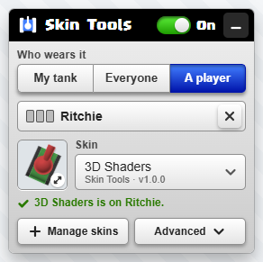
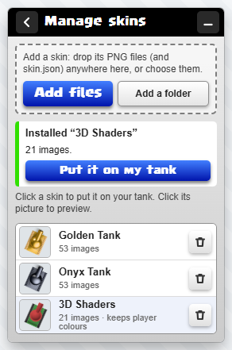
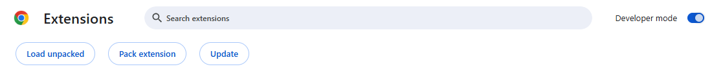

# TankTrouble Skin Tools

Give your tank a new look in [TankTrouble](https://tanktrouble.com). This is a small, **unofficial** add-on for Google Chrome
(and Chrome-based browsers such as Edge and Brave). It changes how tanks look **on your own screen only**. Nobody else
sees it, and the game plays exactly the same.

<p>



</p>

- Choose a skin for your tank, for everyone, or for one player you pick by name.
- Three example skins included: **Golden Tank**, **Onyx Tank** and **3D Shaders** (keeps each player's colours and makes
  their tank look 3D).
- Add skins from friends, or make your own (see [Making your own skin](docs/MAKING-SKINS.md)).
- Recolour body, turret and treads; switch everything off in one click.
- No internet use, no tracking, no permissions. See [Privacy](PRIVACY.md).

## Install

1. Download `TankTrouble-Skin-Tools-1.0.0.zip` and unzip it (right-click → **Extract All…**). Keep the folder somewhere it
   will stay.
2. Open `chrome://extensions`, switch on **Developer mode** (top right), click **Load unpacked** and choose the
   `extension` folder.
3. Go to tanktrouble.com. A small black **Skins** button appears at the bottom right. Click it.
4. **Manage skins → Add a folder** and pick one of the folders in `skin-packs`. Then choose it under **Skin**.



The download also contains **Install-Guide.html**, an illustrated step-by-step guide with troubleshooting.

## Using it

| To | Do this |
|---|---|
| put a skin on your tank | **Who wears it: My tank**, then pick a skin from the list. It applies at once. |
| give everyone a skin | **Everyone**, then pick a skin |
| give one player a skin | **A player**, type part of their name, pick them, then pick a skin |
| recolour | **Advanced → Recolour** |
| go back to normal | the switch at the top: **Off** (your choices are kept) |
| forget every choice | **Advanced → Clear assignments** |
| delete a skin | **Manage skins** → the bin next to it |

Skins are drawn by your browser only. They never reach other players or the game's servers, and hitboxes, speed and
bullets are untouched.

## Privacy and safety

- No network code, no analytics, no remote code, no browser permissions. The add-on runs only on `https://tanktrouble.com`.
- Your skins and choices are stored in your browser, in that site's own storage. Details: [PRIVACY.md](PRIVACY.md).
- Every release is built from an explicit file allowlist and audited entry by entry. See [docs/SECURITY-AUDIT.md](docs/SECURITY-AUDIT.md).

## For developers

Requirements: Node.js 20 or newer. The release check and the screenshot tools also need a local Chrome (or set `CHROME_PATH`).

```
npm ci                       # dev tools only: esbuild (minifier), playwright-core (drives a local Chrome)
npm test                     # unit tests of the pure modules (no browser)
npm run build                # dist/: the release folder, the player ZIP, the extension-only ZIP, INVENTORY.md
npm run audit                # audits the ZIPs entry by entry, and the tracked files of this repository
node tests/release.check.mjs # installs the packaged extension in a fresh Chrome profile and drives it
npm run reproducible         # builds twice and compares every hash
```

| Path | What |
|---|---|
| `extension/` | the add-on source (`manifest.json`, `src/`, `icons/`) |
| `skin-packs/` | the example skins at the game's native size |
| `build/` | `release.config.json` (the allowlist), `build.mjs`, `audit.mjs`, `png.mjs` (lossless PNG optimiser), `zip.mjs` (deterministic ZIP) |
| `guide/` | the install guide (`guide.html`, its screenshots) |
| `tests/` | unit tests and the packaged-release check |
| `tools/` | icon and guide-screenshot generators |
| `docs/` | making skins, the security audit, the release report, the publication checklist |

**How a release is made.** `build/release.config.json` lists every file the release may contain and why. The build
fails if a listed source is missing or if anything appears that no rule produced. Runtime JavaScript is concatenated per
content-script group and minified (the panel's CSS too). PNGs are re-encoded losslessly with all metadata dropped and
checked pixel for pixel. The ZIPs are written deterministically, then read back and audited for personal data,
credentials, local paths, private references, metadata and network or automation code. Put personal patterns to check
(your name, username, e-mail) in `build/private-patterns.txt`; that file is gitignored.

## Credits

- 3D Shaders is rendered from the "TankTrouble in 3D" model by asger-finding (CC0 1.0).
- See [THIRD-PARTY-NOTICES.md](THIRD-PARTY-NOTICES.md). TankTrouble is a trademark of its owners; this project is not
  affiliated with or endorsed by them.

## Licence

[MIT](LICENSE).
