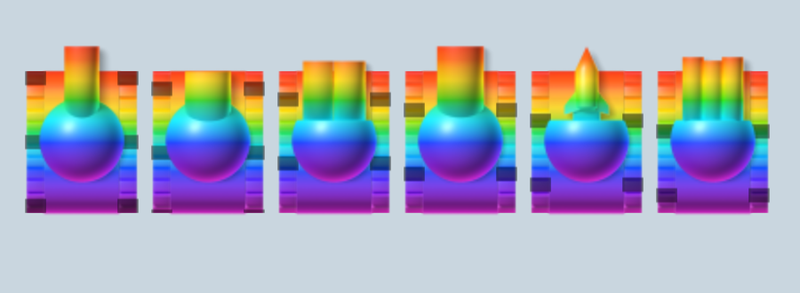
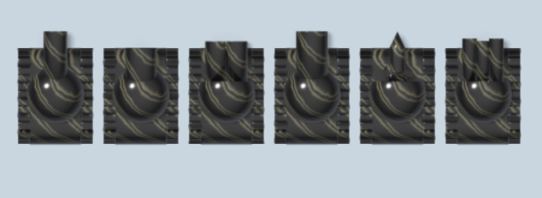
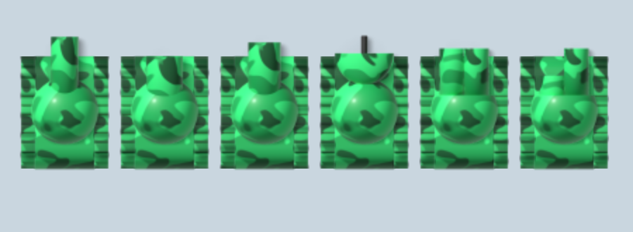
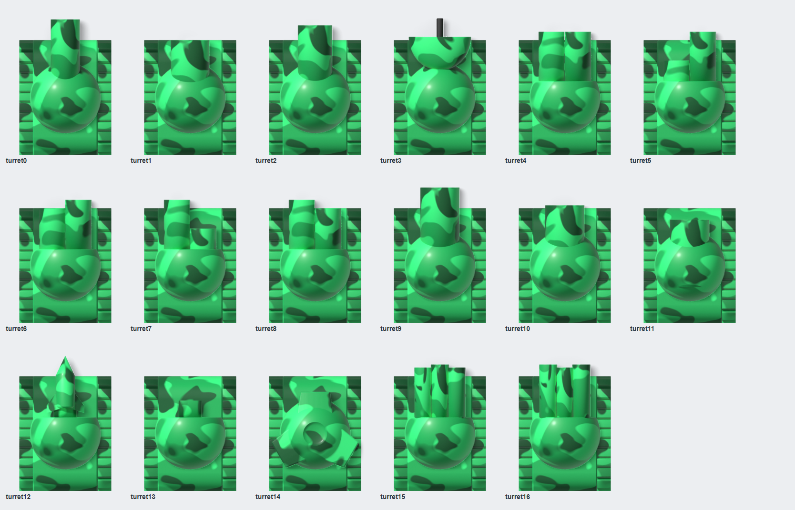
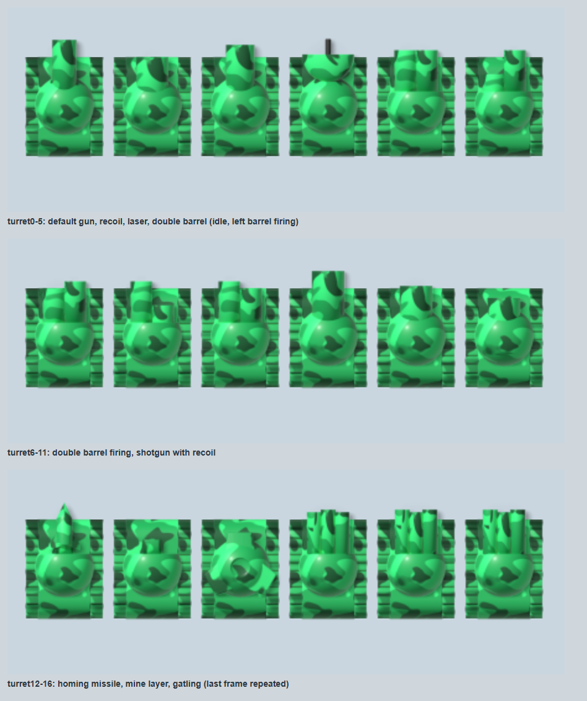

# Skin collection

Extra skins for [TankTrouble Skin Tools](../README.md): fully rendered 3D tanks, each a separate, optional download. The main add-on download stays
small and does not contain them.

| Skin | Download | Preview |
|---|---|---|
| **Rainbow Paint (3D)**: the game's rainbow paint, red at the top of every part to violet at the bottom | `TankTrouble-Skin-Rainbow-Paint-3D-1.0.0.zip` |  |
| **Onyx Paint (3D)**: polished black onyx, thin grey-gold veins, soft moving tread bands | `TankTrouble-Skin-Onyx-Paint-3D-1.0.0.zip` |  |
| **Backer Paint (3D)**: the green Backer camouflage as real 3D paint: emerald and forest-green patches that wrap the dome and barrel | `TankTrouble-Skin-Backer-Paint-3D-1.0.0.zip` |  |

Every skin is painted (it ignores players' colours), keeps the original tank silhouette, and has all 17 turret frames (default gun and recoil, laser, double barrel,
shotgun, homing missile, mine layer, gatling gun), the missile, mine, mine shrapnel, tank fragments and explosion, smoke, dust and puff effects.
**The shield, bullets and crates are the game's own.**

### Backer Paint (3D): every weapon frame

The same camouflage on the same tank in all 17 turret frames, rendered at 4x:



And at the game's size, in the game's real renderer:



## For players: install a skin

You do **not** need Blender, Node.js or Photoshop.

1. Install Skin Tools (see the [main README](../README.md)).
2. Download the skin's ZIP from the [Releases page](../../../releases) and unzip it. The ZIP holds one folder (the skin) and three small text files.
3. On tanktrouble.com open **Skins → Manage skins → Add a folder** and pick the skin's folder. Then choose it under **Skin**.

Each ZIP is about 200-300 KB: the skin at the game's native size, `INSTALL.txt`, `CREDITS.txt` and `LICENSE.txt`, and nothing else.

## For artists and developers: what is in this folder

| Path | What |
|---|---|
| `<skin>/skin/` | the finished artwork at 4x, ready for the importer (`skin.json` + PNGs) |
| `<skin>/*.psd` | layered working files: tank, weapon visuals and scene effects |
| `<skin>/blender/render.py` | the Blender renderer (material, lighting, top-down orthographic camera) |
| `<skin>/fx-art.mjs`, `src/*.svg` | the soft effect sprites, as SVG |
| `<skin>/build.mjs` | Blender + SVG -> layered PSDs -> `skin/`, validated with the extension's importer rules |
| `<skin>/screenshots/` | results in the game's real renderer |
| `tools/` | the shared PSD template, PSD reader/writer, exporter, a frame assembler and the silhouette check |
| `packs.json`, `build-packs.mjs` | the player downloads: `node skins/build-packs.mjs` writes `dist-skins/*.zip` and `REPORT.md` |

```
npm test                       # includes tests/skins.test.mjs
node skins/build-packs.mjs     # the player ZIPs, with every check and the audit
node tests/skins.check.mjs     # installs each ZIP into a fresh Chrome profile with the packaged extension
node skins/<skin>/build.mjs --source <tanktrouble-in-3d.blend>    # re-render (Blender 5.x)
node skins/<skin>/build.mjs --no-render                           # rebuild PSDs and skin/ from the saved renders (needs the local render/ folder)
```

The model is [tanktrouble-in-3d](https://github.com/asger-finding/tanktrouble-in-3d) by asger-finding (CC0 1.0). The `.blend` file is not stored here:
download it and pass it with `--source`. The raw Blender renders (`render/`) are local only; the PSDs hold the same pixels as layers.
The effect sprites are rasterised with a local Chrome, so rebuilding them may differ from the committed art by a few anti-aliased pixels.

The silhouette check (`tools/silhouette.mjs`) compares a skin with crops of the game's own frames. Those crops are the game's artwork, so they are never
committed: put them in `skins/reference/` (git-ignored) or point `TT_REFERENCE_DIR` at them.

Credits and licence: [NOTICES.md](NOTICES.md) and [LICENSE](LICENSE) (MIT, Bleed).
